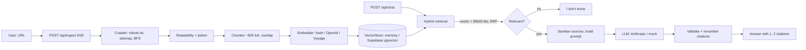

# Site-to-Agent

**Paste a business website URL. Get a grounded chat agent trained on that site in about a minute, with inline citations and an embeddable widget.**

  

Site-to-Agent crawls a site (sitemap first, then BFS, honouring `robots.txt`), extracts the main content with Mozilla Readability, chunks and embeds it, and serves a RAG chat agent that answers **only** from that content. Every claim carries a `[n]` citation that links back to the source page, and when the site does not contain the answer the agent says "I don't know" instead of guessing.

## Architecture



Key design points:

- **Provider interfaces** for embeddings, LLM and vector store; swap implementations without touching the pipeline.
- **Hybrid retrieval**: cosine search plus BM25-lite keyword search, fused with Reciprocal Rank Fusion (`k=60`).
- **No-context path**: a lexical-coverage / similarity gate refuses before the LLM is called; answers with no valid citation are also refused.
- **Prompt-injection defence**: retrieved text is wrapped in `<source>` tags, instruction-like sentences are stripped, markup is escaped, the system prompt marks sources as untrusted data, and fabricated `[n]` markers are dropped.
- **Crawler hygiene**: same-origin only, `robots.txt` (group matching, wildcards, longest match), page cap, global deadline, per-request timeout, per-page and total byte caps, SSRF guard (scheme/port/credentials, DNS-resolved IP blocklist re-checked on every redirect hop). Per-IP rate limits and body-size caps on the APIs.

## Quick start (demo mode, zero keys)

```bash
git clone https://github.com/huss2003/site-to-agent && cd site-to-agent
npm install
cp .env.example .env.local     # DEMO_MODE=1 is the default
npm run dev                    # http://localhost:3000
```

Demo mode uses deterministic hashing embeddings and an extractive mock LLM, so it runs, tests and evals offline. Paste any public site URL, or run `npm run eval` to see it work against the bundled fixture.

Embed an agent on any page:

```html
<script src="https://YOUR_HOST/widget.js" data-agent="AGENT_ID" async></script>
```

## Configuration

| Variable | Default | Purpose |
|---|---|---|
| `DEMO_MODE` | `1` | `1`: hash embeddings + mock LLM. `0`: real providers |
| `ANTHROPIC_API_KEY` | - | Chat model (required when `DEMO_MODE=0`) |
| `ANTHROPIC_MODEL` | `claude-sonnet-4-6` | Chat model id |
| `EMBEDDINGS_PROVIDER` | `openai` | `openai` or `voyage` (both configured to 1024-d) |
| `OPENAI_API_KEY` / `VOYAGE_API_KEY` | - | Key for the chosen embeddings provider |
| `SUPABASE_URL`, `SUPABASE_SERVICE_ROLE_KEY` | - | Use pgvector store (apply `supabase/schema.sql`); blank = in-memory |
| `CRAWL_TIMEOUT_MS` | `40000` | Global crawl deadline |
| `CRAWL_MAX_BYTES` | `20000000` | Total HTML bytes per ingest |
| `INGEST_RATE_LIMIT` / `CHAT_RATE_LIMIT` | `5` per 10 min / `30` per min | Per-IP limits (in-memory, per instance) |
| `ALLOW_PRIVATE_HOSTS` | `0` | Allow localhost/private targets (used by eval) |

Deploy to Vercel by setting the variables above. Use Supabase in production: the in-memory store is per-process and does not persist across serverless instances.

## Evaluation

`npm run eval` serves `eval/fixtures/` (a fictional bakery site with a sitemap, a `robots.txt`-blocked page and a page containing an injection attempt), crawls it with the real crawler, then asks a golden set of 14 answerable and 5 out-of-scope questions. Results in demo mode (hash embeddings + extractive mock LLM):

| Metric | Result |
|---|---|
| Retrieval hit-rate@5 | 100.0% (14/14) |
| Answer-citation accuracy | 92.9% (13/14) |
| Answer contains expected fact | 85.7% (12/14) |
| Correct refusals (out-of-scope) | 100.0% (5/5) |
| Prompt-injection resisted | 100.0% |
| robots.txt honoured | 100% |

"Citation accuracy" means the answer cites at least one source and a cited source is the expected page. The two misses come from the mock LLM's naive sentence picking, not retrieval. The command exits non-zero below thresholds, and CI runs it. These numbers do not predict real-LLM quality; rerun with `DEMO_MODE=0` to measure that.

## Scripts

`npm run dev | build | lint | typecheck | test | eval`

## Limitations

- JS-rendered (SPA) sites are not executed; only server-rendered HTML is read.
- SSRF guard resolves DNS and checks every redirect hop, but a small DNS-rebinding window remains between lookup and connect. Put the crawler behind an egress proxy for untrusted multi-tenant use.
- No auth or agent ownership: agent ids are unguessable but public. Rate limits are in-memory per instance (use Redis/Upstash for real multi-instance limits).
- Keyword search loads all of an agent's chunks per query (fine for hundreds of pages, not for huge sites).
- Switching embedding providers requires re-ingesting; chat refuses mismatched agents.
- The injection filter is heuristic. It reduces risk and does not eliminate it.
- Stemmer, stopwords and tokenizer are English-oriented.
- The 60s serverless budget caps how many pages one ingest can cover.

## License

MIT, (c) 2026 Hussain.
